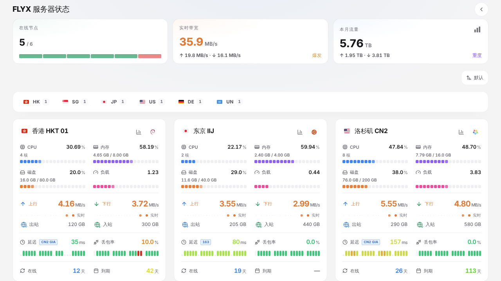

# LuminaPlus for FLYX

[FLYX](https://github.com/kure29/flyx) 面板的状态页主题，保留原版 LuminaPlus 的高信息密度卡片、响应式布局、资源图表和背景外观。

本项目从 [kure29/Monitor-Theme-LuminaPlus](https://github.com/kure29/Monitor-Theme-LuminaPlus) 移植，
后者基于 [shanyang242/Komari-Theme-LuminaPlus](https://github.com/shanyang242/Komari-Theme-LuminaPlus)，继续遵循 MIT 许可证。



## 安装

需要 FLYX 3.9.0 以上（状态页主题、公开历史接口、主题设置和回程线路都在这个版本里）。

1. FLYX 后台 **设置 → 状态页**，开启状态页。
2. **设置 → 状态页 → 主题 → 从 GitHub 安装**，填写仓库地址：

   ```text
   https://github.com/kure29/Flyx-Theme-LuminaPlus
   ```

3. 在主题列表里选择 LuminaPlus。之后点主题卡片上的 **检查更新** 即可升级到最新 Release。

也可以在 [Releases](https://github.com/kure29/Flyx-Theme-LuminaPlus/releases) 下载 `theme.tar.gz`，
在同一页面上传安装。

## 主题设置

主题卡片上的 **设置** 可以修改默认外观（跟随系统/浅色/深色）、电脑和手机的默认视图
（大卡片/小卡片/迷你/列表）、首页显示的内容、是否显示全部测试点、背景图片或视频、卡片透明度、
背景遮罩、飘落动效和各项指标的颜色。设置对所有访客生效；访客在悬浮按钮里切换的外观和视图
只保存在自己的浏览器里。

## 数据从哪里来

主题只用 FLYX 的公开接口（`flyxApi` 1）：

- `/api/v1/public/status`：服务器列表和实时状态，每 10 秒左右刷新一次。
- `/api/v1/public/status/history`、`/ping-history`：详情页的资源和延迟图表（1 小时、6 小时、1 天、7 天）。
- `/api/v1/public/status/theme-config`：后台保存的主题设置。

具体说明：

- **地区**：依次看
  1. 主题设置「服务器地区」：每行一条「服务器名=地区」（如「香港01=HK」「家里的 NAS=中国」，名称写一部分也行）；
  2. 服务器名里的国旗 emoji（任意位置，如「🇭🇰 香港 01」，名称里不再重复这面旗）；
  3. 面板给出的地区：较新的 FLYX 按服务器地址自动识别国家，也可以在「服务器 → 编辑 → 地区」手动指定；
  4. 服务器名里的国家或城市名（「香港 01」「东京 IIJ」「Los Angeles」）或独立的两位大写代码（「HK-01」「[SG] ARM」）。

  都没有的服务器不显示旗帜。旗帜图片加载不到时显示国旗 emoji。
- **延迟**：首页每台服务器默认显示第一个测试点（后台固定的测试点在前），设置里打开
  「卡片显示全部测试点」后显示全部。面板检测过回程线路的测试点会在延迟旁显示线路名
  （如「CN2 GIA」），双栈且 IPv6 回程不同时，鼠标悬停可以看到 IPv6 线路。
- **流量**：本月流量来自面板的按月统计；「今日流量」由 24 小时网速历史估算（平均网速 × 时长）。
  管理员关闭「显示网速和流量」时，网速、流量相关的卡片和行都不显示。
- **系统信息**：系统、架构、虚拟化、CPU 型号需要管理员开启「显示系统信息」，且 agent 为 3.9.0 以上。
- FLYX 没有的数据（价格与资产统计、账单周期、标签、分组、公开备注、流量上限等）自动隐藏。

## 与原版（monitor）相比

- 数据层换成 FLYX 公开接口，去掉 monitor 的 `/api/ws` 实时推送、Ping 任务分配和登录相关功能。
- 去掉「模拟延迟」：没有真实延迟数据的服务器显示「暂无延迟数据」。
- 去掉主题自带的设置页和配色取色器，改为在 FLYX 后台按 `theme.json` 的 `config` 生成的表单里修改；
  主题读取设置时按声明补默认值并检查类型和范围。
- 资产统计页在没有价格数据时不显示入口。

## 开发

```bash
npm ci
npm run dev
```

打开 `http://localhost:5173/status/?mock=1` 用内置的模拟数据预览（`&traffic=0` 模拟关闭网速和流量，
`&disabled=1` 模拟状态页未开启）。连接真实面板时，先运行 FLYX 后端（`cd go-backend && go run ./cmd/paneld`，
默认 `:6365`）并开启状态页，开发服务器会把 `/api` 代理过去；其他地址用 `FLYX_API=http://host:port npm run dev`。

提交前运行：

```bash
npm run typecheck
npm run lint
npm test
npm run build
```

## 打包与发布

```bash
npm run package
```

在仓库根目录生成 `theme.tar.gz`，根目录直接是 `theme.json`、`preview.png` 和 `dist/`。

发布新版本：同时修改 `theme.json` 和 `package.json` 的 `version`，合并到 `main` 后在 Actions 里运行
**release** 工作流并勾选 `publish`，工作流会构建、检查包的结构和大小，按版本号打 `vX.Y.Z` tag 并创建
Release、上传 `theme.tar.gz`。也可以直接推送 `vX.Y.Z` tag 触发，tag 必须和 `version` 一致。

## 致谢

- [shanyang242/Komari-Theme-LuminaPlus](https://github.com/shanyang242/Komari-Theme-LuminaPlus)
- [stqfdyr/komari-theme-Lumina](https://github.com/stqfdyr/komari-theme-Lumina)
- [kure29/Monitor-Theme-LuminaPlus](https://github.com/kure29/Monitor-Theme-LuminaPlus)

## 许可证

MIT。分发修改版本时请保留原项目及本项目的版权和许可声明。
